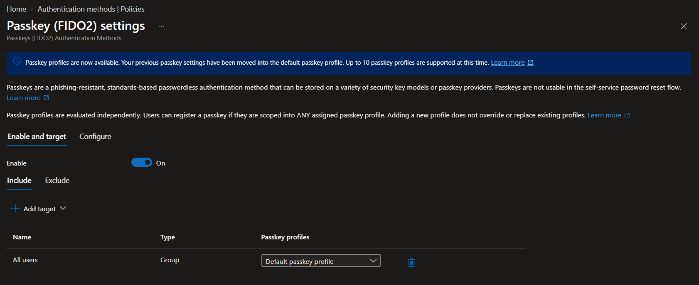
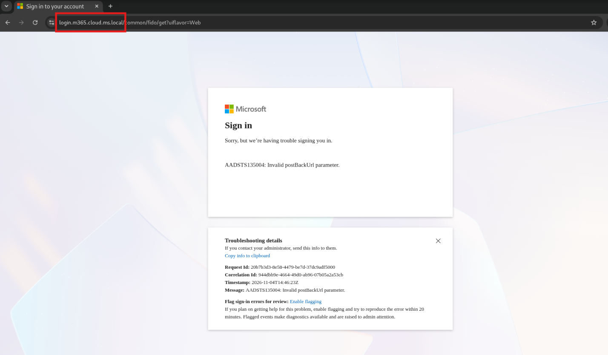
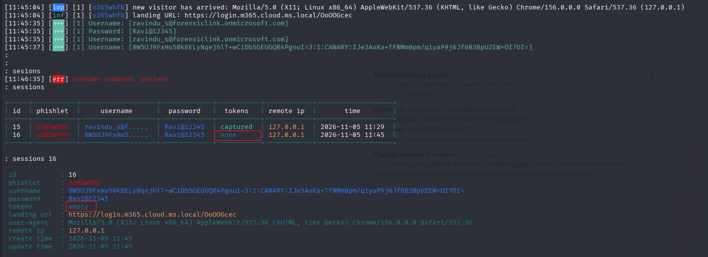

# AiTM Phishing vs. FIDO2 Passkeys — Lab Report

A hands-on lab demonstrating how Adversary-in-the-Middle (AiTM) reverse-proxy phishing bypasses traditional MFA (OTP/push) against a real Microsoft Entra ID tenant and how switching the account to a FIDO2 passkey stops the same attack at the protocol level.

> **Scope and ethics:** Everything here ran inside an isolated lab network against a synthetic Microsoft Entra ID tenant and a throwaway test account created solely for this exercise. No real users, production systems, or third parties were involved. This repo is for educational and portfolio purposes only.

## Summary

| | Experiment 1 — Standard MFA | Experiment 2 — FIDO2 Passkey |
|---|---|---|
| MFA factor | OTP / push via Microsoft Authenticator | FIDO2/WebAuthn platform passkey |
| MFA challenge | Proxied and approved successfully | Blocked by browser-enforced origin check |
| Error surfaced | None — flow completed normally | `AADSTS135004` |
| Session cookie issued | `ESTSAUTH` captured | None captured |
| Account takeover | **Achieved** | **Prevented** |

The two experiments used the identical phishing domain, certificate trust chain, and Evilginx2 phishlet. The only variable was the authentication method registered on the test account  which isolates the result to the authentication method itself.

## Why

Traditional OTP and push-based MFA verify the user's identity but do not verify whether the authentication request is reaching the legitimate identity provider. A reverse proxy such as Evilginx2 can position itself between the victim and the real identity provider, transparently forwarding authentication requests and MFA challenges. This allows the victim to approve a seemingly legitimate sign-in, after which the attacker can capture and replay the resulting session cookie to gain access without repeating the password or MFA process.

FIDO2/WebAuthn addresses this weakness through origin binding. The browser incorporates the actual website origin into the authentication process, ensuring that the passkey is used only with the domain to which it is registered. Although a proxy can relay authentication requests, it cannot change the origin verified by the browser. As a result, authentication through an unauthorised phishing domain fails, preventing the attacker from obtaining an authenticated session through this method.

## Lab environment

| Component | Configuration |
|---|---|
| Attacker host | Kali Linux, Evilginx2 (developer mode) |
| Phishing domain | `login.m365.cloud.ms.local`, resolved via local hosts file |
| TLS trust | Locally generated Root CA, trusted on the victim browser only |
| Identity provider | Free Microsoft Entra ID (Azure AD) tenant, created for this lab |
| Test account | Synthetic account, no production data or access |

## Evidence

**Experiment 1 — standard MFA bypassed:**

| | |
|---|---|
|  |  |
| Lure delivered to the synthetic victim | Evilginx2 proxying the sign-in flow |
|  |  |
| `ESTSAUTH` captured mid-proxy | Account takeover via cookie replay |

**Experiment 2 — FIDO2 passkey holds:**

| | |
|---|---|
|  |  |
| Passkey enabled tenant-wide | Proxy halted by the origin check |
|  | |
| Evilginx2's log shows no session ever issued | |

All 17 screenshots are in [`/evidence`](evidence), numbered to match the figure references in the full report.

## Full report

The complete write-up — background, lab setup, full experiment walkthroughs, security analysis, and references — is in [`/report`](report/AiTM_Phishing_vs_FIDO2_Passkeys_Lab_Report.docx).

## Tools used

- [Evilginx2](https://github.com/kgretzky/evilginx2) — reverse-proxy phishing framework
- Microsoft Entra ID (free tenant)

## License

[MIT](LICENSE)
