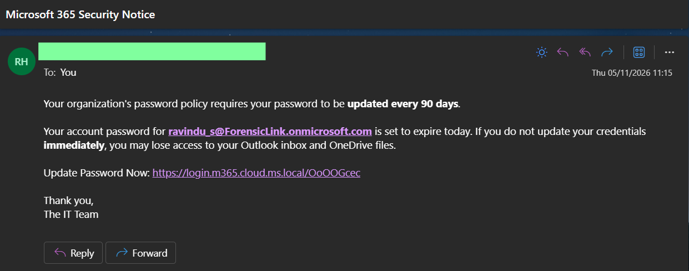
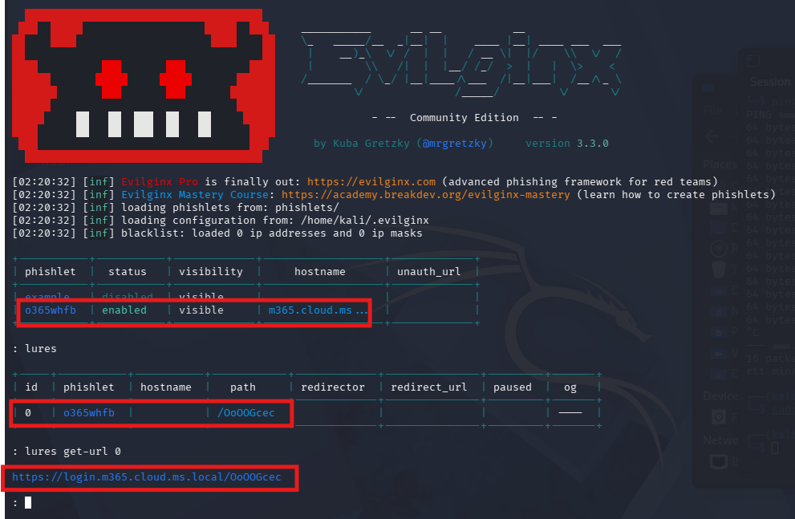
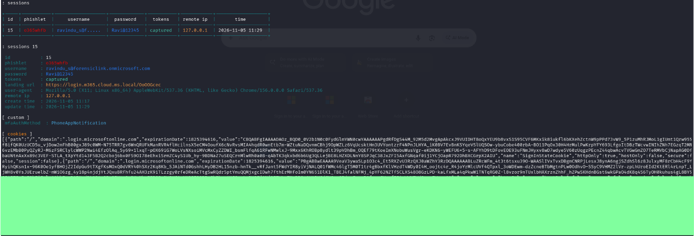
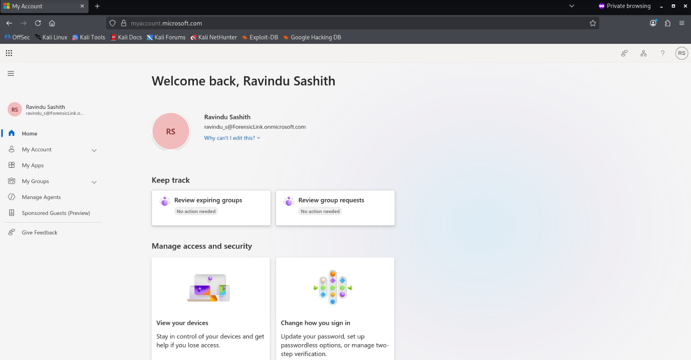

# AiTM Phishing vs. FIDO2 Passkeys — Lab Report

A hands-on lab demonstrating how Adversary-in-the-Middle (AiTM) reverse-proxy phishing bypasses traditional MFA (OTP/push) against a real Microsoft Entra ID tenant — and how switching the account to a FIDO2 passkey stops the same attack at the protocol level.

> **Scope and ethics:** Everything here ran inside an isolated lab network against a synthetic Microsoft Entra ID tenant and a throwaway test account created solely for this exercise. No real users, production systems, or third parties were involved. This repo is for educational and portfolio purposes only.

## Summary

| | Experiment 1 — Standard MFA | Experiment 2 — FIDO2 Passkey |
|---|---|---|
| MFA factor | OTP / push via Microsoft Authenticator | FIDO2/WebAuthn platform passkey |
| MFA challenge | Proxied and approved successfully | Blocked by browser-enforced origin check |
| Error surfaced | None — flow completed normally | `AADSTS135004` |
| Session cookie issued | `ESTSAUTH` captured | None captured |
| Account takeover | **Achieved** | **Prevented** |

The two experiments used the identical phishing domain, certificate trust chain, and Evilginx2 phishlet. The only variable was the authentication method registered on the test account — which isolates the result to the authentication method itself.

## Why

OTP and push MFA prove *who* is signing in, not *where* the request is terminating. A reverse proxy (Evilginx2) sits transparently between the victim and the real identity provider, relaying every request and response — including the genuine MFA challenge — so the victim approves a sign-in that looks completely normal. Once approved, the resulting session cookie is captured and replayed, bypassing both the password and the MFA step entirely.

FIDO2/WebAuthn closes this gap with **origin binding**: the browser signs the authentication challenge together with the actual page origin it's talking to. A proxy can relay bytes, but it can't make the browser believe it's talking to `login.microsoftonline.com` when the address bar reads something else — so the ceremony fails before any token is ever issued.

## Lab environment

| Component | Configuration |
|---|---|
| Attacker host | Kali Linux, Evilginx2 (developer mode) |
| Phishing domain | `login.m365.cloud.ms.local`, resolved via local hosts file |
| TLS trust | Locally generated Root CA, trusted on the victim browser only |
| Identity provider | Free Microsoft Entra ID (Azure AD) tenant, created for this lab |
| Test account | Synthetic account, no production data or access |

## Evidence

**Experiment 1 — standard MFA bypassed:**

| | |
|---|---|
|  |  |
| Lure delivered to the synthetic victim | Evilginx2 proxying the sign-in flow |
|  |  |
| `ESTSAUTH` captured mid-proxy | Account takeover via cookie replay |

**Experiment 2 — FIDO2 passkey holds:**

| | |
|---|---|
|  |  |
| Passkey enabled tenant-wide | Proxy halted by the origin check |
|  | |
| Evilginx2's log shows no session ever issued | |

All 17 screenshots are in [`/evidence`](evidence), numbered to match the figure references in the full report.

## Recommendations

- Require FIDO2 hardware keys or platform passkeys as the primary authentication factor, especially for privileged accounts.
- Enforce phishing-resistant authentication strength through Conditional Access rather than leaving it optional.
- Enable Continuous Access Evaluation (CAE) to shrink the usefulness window of any stolen session token.
- Apply token-protection and sign-in risk policies as a layer of defense while rolling out passkeys.
- Train users to check the address bar domain — the one layer of this attack that isn't closed by a technical control.

## Full report

The complete write-up — background, lab setup, full experiment walkthroughs, security analysis, and references — is in [`/report`](report/AiTM_Phishing_vs_FIDO2_Passkeys_Lab_Report.docx).

## Tools used

- [Evilginx2](https://github.com/kgretzky/evilginx2) — reverse-proxy phishing framework
- Microsoft Entra ID (free tenant)
- FIDO2/WebAuthn passkeys

## License

[MIT](LICENSE)
